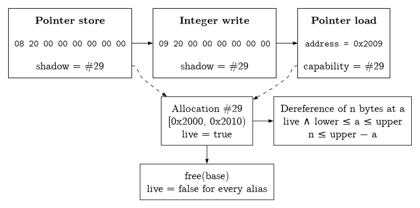

The translator lowers the Fil-C typed AST before instrumentation into a standalone Haskell module with an embedded capability runtime, using frontend record layouts and preserving 128-bit integers and real and complex values through x87 extended precision.


Record offsets preserve packed members and bit-fields, while aggregate copies carry payload and shadow slots together and variadic calls expose a read-only argument area with alignment and independent `va_copy` cursors. Computed jumps validate label identity before dispatch, and pthread workers share allocations and scalar atomics while initialising independent thread-local storage.

Runtime array bounds are captured at declarations and function entry, with byte strides retained for indexing, pointer arithmetic and `sizeof` even after the variables used to compute the bounds have changed.

## Memory

Pointers carry an allocation capability independently of their numeric address while each shared object stores byte payloads, shadow capabilities, bounds and liveness, allowing integer writes to modify pointer bytes without replacing the associated allocation identity.



Every access checks the complete byte span against a live allocation and pointer slots require eight-byte alignment, while freeing an object invalidates its aliases through the shared record and unreachable allocations remain reclaimable after local addresses escape.

## Build

```sh
export FILCC=/path/to/filc/build/bin/clang
dune build --profile release
dune exec --profile release -- heresy examples/codec.c --build build/codec
./build/codec pack examples/flows.c build/flows.hrlz
./build/codec unpack build/flows.hrlz build/restored.c
cmp examples/flows.c build/restored.c
```

The codec uses hash-indexed LZ77 with overlapping back-references and growing input buffers while the packet analyser aggregates bidirectional IPv4 TCP/UDP flows from classic Ethernet PCAP, with binary file contents and filesystem names preserved through the runtime boundary.

## Verification

```sh
dune runtest --profile release
lake build
```

The differential suite compares generated execution with native Fil-C across memory, layout, control flow and I/O. The Lean certificate checks emitted unsigned integer kernels against the Fil-C AST in CI, while correspondence for the general lowering and runtime remains unproved.
