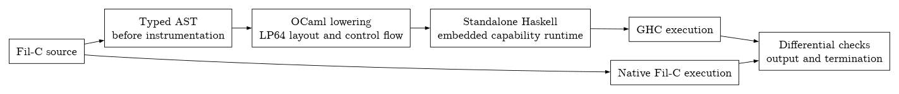

The translator lowers the Fil-C typed AST before instrumentation into a standalone Haskell module, computing LP64 layout in OCaml and carrying integer, binary32, binary64 and pointer values through an embedded capability runtime.



Layouts cover named structures, unions, nested arrays and flexible array members, with aggregate calls and returns copying payload and shadow slots together while scalar calls use eight-byte slots. Variadic calls expose a read-only argument area with independent `va_copy` cursors, while switch fall-through and jumps to labels lower to explicit continuations over shared frame storage.

## Memory

Pointers carry an allocation capability independently of their numeric address while each shared object stores byte payloads, shadow capabilities, bounds and liveness, allowing integer writes to modify pointer bytes without replacing the associated allocation identity.


Every access checks the complete byte span against a live allocation and pointer slots require eight-byte alignment, while freeing an object invalidates its aliases through the shared record and unreachable allocations remain reclaimable after local addresses escape.

## Build

```sh
export FILCC=/path/to/filc/build/bin/clang
dune build --profile release
dune exec --profile release -- heresy examples/codec.c --build build/codec
./build/codec pack examples/flows.c build/flows.hrlz
./build/codec unpack build/flows.hrlz build/restored.c
cmp examples/flows.c build/restored.c
```

The codec uses hash-indexed LZ77 with overlapping back-references and growing input buffers while the packet analyser aggregates bidirectional IPv4 TCP/UDP flows from classic Ethernet PCAP, with binary file contents and filesystem names preserved through the runtime boundary.

## Verification

```sh
dune runtest --profile release
lake build
```

The differential suite compares generated execution with native Fil-C across memory, layout, control flow and I/O regressions while the Lean development checks a separate model whose correspondence with the implementation remains unproved.
